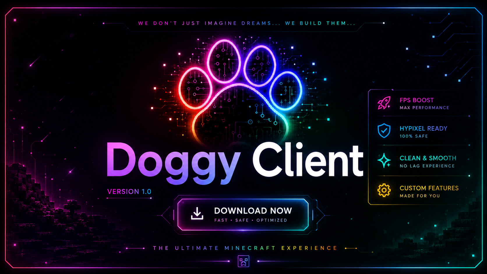

  

 

# 🐶 DOGGY CLIENT

### WE DON'T JUST IMAGINE DREAMS. WE BUILD THEM.

**A Minecraft 1.8.9 PvP Client**

Performance • Customization • Creativity

---

## 🌲 ABOUT DOGGY CLIENT

Doggy Client is a custom Minecraft 1.8.9 PvP client built with creativity, passion and a focus on performance.

Our goal is to create a smooth, customizable and enjoyable experience for Minecraft players.

We don't just imagine dreams. We build them.

## ✨ FEATURES

- ⚡ Performance-focused experience
- 🎨 Custom interface and visual design
- 🎵 DoggyMusic
- 🐶 Unique Doggy Client identity
- ⚙️ Customization and configuration

## 📥 DOWNLOAD

Get the latest official version of Doggy Client.

## 🛠️ INSTALLATION

1. Download the latest installer.
2. Run the installer.
3. Follow the installation instructions.
4. Launch Doggy Client and enjoy!

## 📸 SCREENSHOTS

Coming soon...

🚀 IT'S FINALLY HAPPENING!

🐶 OFFICIAL RELEASE: NOVEMBER 12, 2026

## 📋 CHANGELOG

Check the official Releases page for updates and version history.

[View All Releases](https://github.com/HeyDoggy/DoggyClient/releases)

---

### 🐶 DOGGY CLIENT

## 🧪 BETA VERSION — EARLY RELEASE

**Doggy Client is currently in its early Beta stage.**

This is our first experimental release, and we're still working hard to improve the experience.

We sincerely apologize if you encounter any bugs, errors, or unexpected issues while using the client. Please remember that this is an early testing version, and some features may not work perfectly yet.

We truly hope you enjoy using Doggy Client, and we hope you'll be satisfied with what we've built.

**Thank you for being part of our journey. Your support means a lot to us. ❤️**

## 🚀 UPDATE ROADMAP

on november 12, you'll receive **update #1**, along with the very first official release of doggy client!

updates **#2 through #10** are planned to roll out gradually over the next **2 years**. that's right! doggy client is a long-term project, and it's planned to keep receiving updates, improvements, and new features throughout these two years.

i want doggy client to keep growing with its community. so if you'd like to see new mods or features that don't give players an unfair advantage over others, but simply make the game look better, feel more enjoyable, and stay lightweight, please share your suggestions with me!

**every suggestion matters.** i promise that every single suggestion will be carefully reviewed and considered for future updates.

let's build something amazing together. ❤️🌲

----------------------------------------------
**Built with ❤️ by Amir = Sbiw / JigarTala**

*Dream it. Build it. Experience it.*

